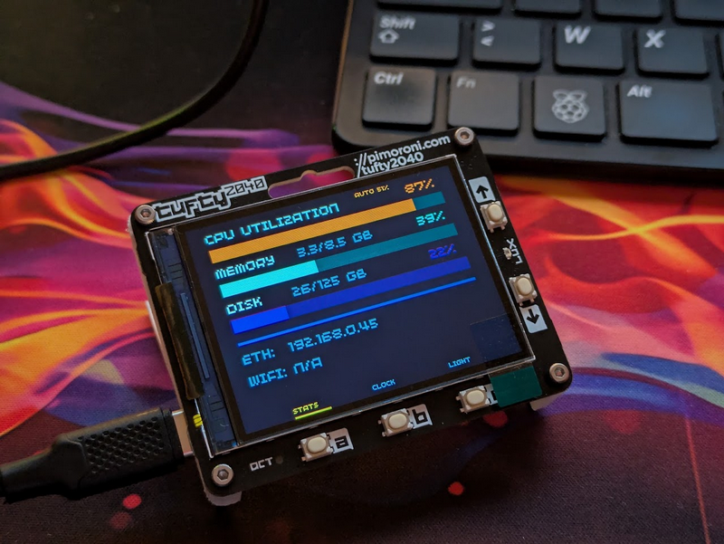

# 📊 Tufty 2040 LCARS System Monitor



A **Star Trek LCARS** style system monitoring tool for Raspberry Pi using a **Pimoroni Tufty 2040** (RP2040) display.

## 🎮 Features
- **Standby / Waiting Screen:** Displays an LCARS standby status until initial data is received over USB.
- **Real-time Metrics:** Monitors CPU, RAM, Disk Usage, and active network IPs (ETH/WIFI).
- **Dynamic Gauge Colors:** Color transitions automatically based on workload (Normal → Amber at 80% → Red at 90%).
- **Auto Brightness:** Ambient light adjustment using the built-in phototransistor (with a safe floor at 50%).
- **Clock Mode:** Switchable via Button B (RTC Clock + Stardate display).
- **Background Service:** Includes Systemd integration to launch automatically at host boot.
- **Defensive Firmware Safeguards:** Button input debouncing (15 ms edge-hold, kills single-frame glitches) and a startup memory headroom check (refuses to boot if free heap < 8 KB).
- **Battery / Power Indicator:** On-screen battery icon (top-right) with fill level from an ADC-29 voltage measurement, USB-bolt overlay when VBUS is present, and a red low-battery state at/below 20 %. Hidden automatically when no battery is connected.

---

## 🛠️ Project Architecture

- `host/`: Python script running on the host computer to collect and stream metrics over Serial (USB), along with Systemd setup scripts.
- `tufty/`: MicroPython script running directly on the Pimoroni Tufty 2040.

---

## ⚡ Quick Start

### 1. Preparing the Tufty 2040
1. Flash the latest **Pimoroni PicoGraphics** MicroPython firmware for Tufty 2040.
2. Transfer `tufty/main.py` to the root of the MicroPython filesystem — **`mpremote`** (CLI, fastest) or **Thonny IDE** — see [`tufty/README.md`](tufty/README.md).

### 2. Preparing the Raspberry Pi & Installing Service
Run from the **repository root** (the script creates `.venv/` there and installs `host/requirements.txt`):
```bash
chmod +x host/setup_env.sh
./host/setup_env.sh
```
This only creates the venv and installs the Python dependencies. Installing the systemd service is a separate step — see [`docs/setup_guide.md`](docs/setup_guide.md).

### 3. Command Line Arguments (`sender.py`)

| Argument | Type | Default | Description |
| :--- | :--- | :--- | :--- |
| `port` | Positional | *(auto)* | Serial port identifier (e.g. `COM7`, `/dev/ttyACM0`). Optional — if omitted, the RP2040 (VID `0x2E8A`) port is auto-detected and the full port scan is printed. |
| `--baud` | Int | `115200` | Serial baud rate. |
| `-o`, `--offset` | Int | `0` | Timezone offset in hours relative to system time. |
| `-d`, `--debug` | Flag | `False` | Enables printing serial responses and logs received from the Tufty 2040. |

---

## Manual Execution

Run the host sender script with your timezone offset (the serial port is optional — the Tufty 2040 port is auto-detected if omitted):

```bash
# Example for Windows on COM7 with UTC+2 timezone offset:
python host/sender.py COM7 -o 2

# Example for Linux/macOS on /dev/ttyACM0 with UTC+1 and debug mode enabled:
python host/sender.py /dev/ttyACM0 -o 1 --debug
```

---

## Serial Protocol Specification

Frames are sent as UTF-8 single-line strings delimited by pipes (`|`) and terminated with `\n`.

- **Standard Telemetry Payload:**
  ```text
  CPU:12.5|RAM_PCT:48.2|RAM_U:7.7|RAM_T:16.0|DISK_PCT:62.1|DISK_U:310.5|DISK_T:500.0|ETH:192.168.1.50|WIFI:N/A
  ```
- **Time-Sync Payload:** sent as its **own line**, `INIT_TIME:YYYY,MM,DD,HH,MM,SS`. The value is a comma-separated date/time string (not a Unix epoch — MicroPython's `rtc.datetime()` requires it), timezone-shifted by `--offset`. It is sent on startup and then re-sent every 60 s (`SYNC_INTERVAL`), so the Tufty can correct RTC drift:
  ```text
  INIT_TIME:2026,11,12,19,45,00
  ```

---

## Tufty 2040 UI Navigation

- **Button A (STATS):** Display real-time CPU, RAM, Disk, and Network interface status.
- **Button B (CLOCK):** Display full-screen LCARS digital clock, Date, and StarDate derived directly from RP2040 hardware RTC.
- **Button C (LIGHT):** Toggle automatic lux sensor backlight control.
- **Up / Down Buttons:** Manually adjust screen brightness level.
